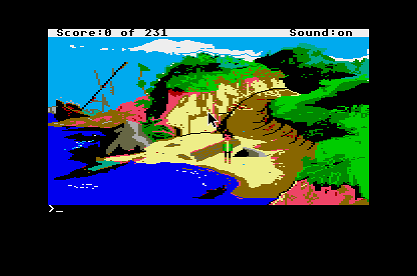
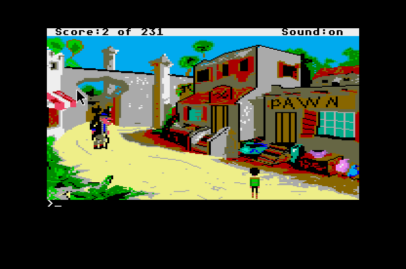

# King's Quest VI for the Atari ST

Bug fixes and mouse controls for the Atari ST version of Brandon Kouri's
[*King's Quest VI AGI Demake*](https://kq6agi.com).



**Want to play?** Download the zip from [Releases](https://github.com/jarnalyrkar/KQ6ST/releases).
It holds a ready game folder for an Atari ST/STE hard disk, Hatari or Steem SSE, with
instructions in `READ_ME.TXT`.

## Background

In 2024 **Brandon Kouri** finished *King's Quest VI AGI Demake*, an 18-year effort (2006–2024)
that rebuilds Sierra's 1992 *King's Quest VI: Heir Today, Gone Tomorrow* in Sierra's older AGI
engine: 16-colour graphics and a typing interface. The same year **Marakatti** made the first
working Atari ST disk image of it, running Brandon's DOS game data, unchanged, on Sierra's own
Atari ST AGI interpreter (version 1.422, from *Mixed-Up Mother Goose*). **Petari (PP)** then
converted that image to run from hard disk, with his own loader.

When the ST version was played through on real hardware (a 1040ST), several scenes crashed:
"memory error"s at the Minotaur, the druids, Charon and Jollo's lamp, illegal instructions at the
magic door and the Night Mare, plus a number of smaller glitches. This project fixes them, and
because the ST has a mouse, it also adds the mouse controls the DOS game cannot have.

The fixes are applied to an unmodified copy of the ST disk image by a build script: patches for the
1987 interpreter (`SIERRA.PRG`), small patches to the game scripts (logic bytecode) and the
vocabulary. The game has been played from start to finish in Hatari (STE, 4 MB, TOS 1.62) with
no crashes or error messages. Testing on a real 1040ST is still to come.



## What has changed

**Crashes fixed**

- "Memory error" at the Minotaur, the druids, Charon and Jollo: the interpreter's game heap is
  enlarged from 64 KB to 128 KB.
- 2 bombs when giving the milk to the baby's tears: freeing memory no longer leaves the sound list
  pointing into freed memory.
- The pawn shop could lose the traded item after using the arrow keys.
- Saving and quitting crashed under the floppy loader: the game now runs from a plain hard-disk
  folder, saves go to that folder, and Quit returns to the desktop.

**Glitches fixed**

- The mouse pointer no longer erases text (title buttons, the spell book).
- Animations (oyster, gnomes, the flames at the Lord of the Dead, the Minotaur) no longer draw over
  open message boxes.
- Black text on blue boxes (the map, the ferryman, the vizier's letter) gets readable colours.
- After the Cliffs of Logic skip on the long path, Alexander no longer goes missing at the top.

**Additions**

- 99 save slots in a scrolling list (instead of 12).
- **Click to interact**: right-click or double-click on something in a room and Alexander walks
  there (finding a way around obstacles) and does the obvious thing with it; 347 hotspots in all
  51 rooms that have commands. A single click walks around obstacles too, and a click at the edge
  of the screen leaves the room that way.
- Push the pointer against the top of the screen to open the menu bar, as in Sierra's other ST games.
- The mouse works in the title choice, the ferryman's and pawn shop's number menus, the inventory
  picker, the vizier's box, the trunk, the beach box and the sword fight. Portrait dialogues close
  on a click.
- Typed commands in the pawn shop (`talk`, `trade`, `give`, `take mint`) and a clickable shop menu.
- `load` works as a synonym for `restore`.
- Esc skips the disclaimers and the title texts.
- The Cliffs of Logic climb is skipped after the first etching.

Full list with dates: [`CHANGELOG.md`](CHANGELOG.md). Open issues are in the bug table in
[`PROJECT.md`](PROJECT.md#the-bug-list-sorted-by-kind-of-fix).

## What is in this repository

The repository holds **only the project's own work**: patches, tools and notes. The game itself
(Brandon's data, Sierra's interpreter, the ST disk image and loader) is not included (see `.gitignore`).

| Path | Contents |
|---|---|
| [`PROJECT.md`](PROJECT.md) | The development notes: current state, who made what, all findings about the ST interpreter and the game scripts, the bug table, how a fix gets onto the ST, the tools and the Hatari test harness. **Start here.** |
| [`CLICK-TO-INTERACT.md`](CLICK-TO-INTERACT.md) | Design notes for click to interact. |
| [`tools/mkhd.sh`](tools/mkhd.sh) | Builds the patched hard-disk game folder from the ST disk image `E.ST`. |
| `tools/mkrelease.sh`, `tools/READ_ME.TXT` | Packs a fresh game folder and the player's readme into the release zip. |
| [`tools/slots/`](tools/slots) | New interpreter code in C (save slots, heap release, mouse menu, pointer, sprite blit, click to interact and pathfinding, number menus, inventory picker) and its linker script. Hotspots per island in `tools/slots/hotspots/`. |
| `tools/patchheap.py`, `tools/patchslots.py` | Interpreter patches: they check the original bytes, then link in the new code. |
| `tools/logicpatches.py`, `tools/agipatch.py`, `tools/wordpatches.py` | Game-script and vocabulary patches. |
| `tools/*.py` | Helpers: FAT12 image reader, TOS program loader and 68000 disassembler, AGI resource reader, logic disassembler, picture renderer, vocabulary dump, hotspot checks and maps. |
| [`tools/hatari/`](tools/hatari) | Headless Hatari test harness and test scripts. |
| `encountered-bugs.txt`, [`bug-images/`](bug-images) | The original bug report from the real-hardware playthrough, with screenshots. |
| `debugging-steps.txt` | Brandon's steps for skipping the crash scenes with the game's debug mode. |
| `BUGS-FOR-BRANDON.txt` | Bugs found in the game data itself (they affect the DOS version too). |

## Building from your own copy

You need Petari's hard-disk release of the ST version; the disk image in it, `FILES/E.ST`, is the input (the
unmodified image has MD5 `814e61fc463c594488d4140e88ca61ef`). Tools needed: Python 3, and an m68k
cross toolchain (`m68k-linux-gnu-gcc-15` and binutils) for the interpreter patches;
`tools/patchslots.py` adds `~/.local/opt/m68k-gcc/root/usr/bin` to the path, so edit that for your
setup. Pillow and Capstone are needed only for the picture and disassembly helpers.

```sh
tools/mkhd.sh path/to/KQVIST/FILES/E.ST build/KQ6ST-HD
hatari --machine ste --memsize 4096 -d build/KQ6ST-HD --auto 'C:\SIERRA.PRG'
```

`build/KQ6ST-HD` is a game folder for an ST hard disk (or Hatari/Steem GEMDOS drive): start
`SIERRA.PRG` from it. `MG.PRG` must stay next to it (the interpreter's copy check looks for it),
and save games are written to the same folder. Do not use Petari's loader with this folder.

`tools/mkrelease.sh <E.ST> VERSION` builds a fresh folder (without save games) and packs it into
`dist/KQ6ST-VERSION.zip` for a release.

## Copyright and licences

**King's Quest is © Sierra On-Line, Inc.** The rights now belong to Activision (Microsoft). This
is a non-commercial fan project, not affiliated with or endorsed by Sierra, Activision or
Microsoft. If you enjoy King's Quest VI, buy the original (it is sold on GOG and Steam).

Copyrighted by others and **not** covered by this project's licence:

- **Sierra's work**: the *King's Quest* name, characters, story and world; the AGI engine; the
  Atari ST AGI interpreter `SIERRA.PRG` (© 1987 Sierra On-Line), which the build patches and
  links with this project's code; and the graphics and sounds that Brandon's game borrows from
  Sierra's games (King's Quest I–VI, Gold Rush, Mixed-Up Mother Goose, Sierra Christmas Card,
  The Black Cauldron, Police Quest I).
- **Brandon Kouri's work**: *King's Quest VI AGI Demake*, its scripts, pictures, views, sounds and
  vocabulary (`LOGDIR`, `VOL.*`, `WORDS.TOK`, `OBJECT` and the other game files).
- **Marakatti's and Petari's work**: the Atari ST disk image, and its hard-disk conversion and loader.
- **Excerpts in this repository**: the patch scripts quote short byte sequences of `SIERRA.PRG`
  and of the game's logic bytecode (to check that each patch hits the right place); the hotspot
  tables use the game's own command words; the notes cite addresses, names and behaviour of the
  original programs; the screenshots in `media/` and `bug-images/` show the game.

The project's own code (shim code, patches, tools, scripts and notes) is licensed under the **GNU
General Public License v3.0 or later** ([`LICENSE`](LICENSE)). `tools/ops.json` is taken from
ScummVM's AGI engine, which is GPLv3+ as well.

## Thank you, Brandon

This project exists because of **Brandon Kouri**, who spent eighteen years building *King's
Quest VI AGI Demake* and gave it away for free. It is one of the largest and most complex AGI
games ever made, and a wonderful tribute to Sierra and to King's Quest VI. Brandon also helped
directly with the debugging: he wrote the steps for skipping past the crash scenes with the game's
debug mode, which made it possible to reach and test them. Thank you, Brandon!

Get the original DOS game and follow his work at [kq6agi.com](https://kq6agi.com).

Thanks also to **Marakatti**, who made the first working Atari ST disk image of Brandon's game,
and to **Petari (PP)**, who converted that image to run from hard disk. This project builds on
their work.

## Built with

- **[ScummVM](https://www.scummvm.org/)** (GPLv3+): its AGI engine was the reference for the
  resource formats, the command set and the interpreter's behaviour.
- **[Hatari](https://www.hatari-emu.org/)** (GPLv2+): the Atari ST/STE emulator used for all
  testing, with its debugger and remote control (`hconsole`).
- **[GCC and GNU Binutils](https://www.gnu.org/)** (GPL): the m68k cross compiler and linker for
  the interpreter code.
- **[Capstone](https://www.capstone-engine.org/)** (BSD): 68000 disassembly.
- **[Python](https://www.python.org/)** and **[Pillow](https://python-pillow.org/)**: the tools.

The development was done together with Claude (Anthropic), an AI assistant.

## Changelog

See [`CHANGELOG.md`](CHANGELOG.md).
